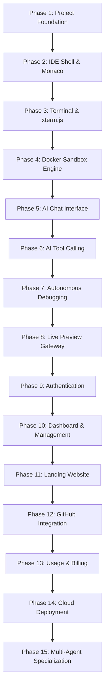

# Kodra - AI-Powered Cloud IDE: Master Engineering Plan

> **Codename:** Kodra  
> **Type:** Full-Stack Cloud Development Environment (SaaS)  
> **Philosophy:** Strict 4-Layer Architecture, Zero Hardcoding, Pure JavaScript, Incremental SaaS-Level Execution.

---

## 1. Executive Summary & Vision

**Kodra** is a cloud-based development environment combining a browser IDE, pseudo-terminal (PTY), isolated Docker execution sandbox, live application preview, and an autonomous AI coding agent.

Unlike standard chatbots that simply spit out code snippets, Kodra operates as an autonomous software engineer inside a secure Linux container:
* Inspects project structures and file contents.
* Creates, edits, and deletes code files safely.
* Executes commands in an isolated Linux environment (builds, tests, package installs).
* Detects compiler, runtime, or syntax errors and automatically iterates to self-heal.
* Exposes live applications through a dynamic reverse-proxy preview gateway.

---

## 2. Core Architectural Principles

1. **Strict 4-Layer Architecture:** Rigid separation of concerns. Presentation never queries data models directly; Services never interact with raw HTTP requests or raw sockets; Repositories isolate storage; Infrastructure adapters isolate external vendors (Docker, AI, Auth).
2. **Zero Hardcoded Configuration:** Every port, URL, timeout, credential, and model identifier is injected via environment variables and validated at startup.
3. **Pure JavaScript (ES Modules):** Clean modern JavaScript (Node.js ESM + React JSX) without TypeScript build overhead.
4. **Incremental SaaS Execution:** Built in strict sequential phases (1 through 15). Every phase leaves the platform in an operable, verifiable state.
5. **Multi-Tenant Isolation:** Project files live in dedicated host workspaces bind-mounted into unprivileged Docker containers with enforced memory, CPU, and PID quotas.

---

## 3. The 4-Layer Software Architecture

```
┌─────────────────────────────────────────────────────────────────────────────┐
│ LAYER 1: PRESENTATION & INTERFACE LAYER                                     │
│  • Express HTTP REST Routers & Controllers                                  │
│  • WebSocket Gateways (TerminalGateway, AgentGateway)                       │
│  • Request DTO Validation & Standardized Response Serialization             │
│  • Middleware: CORS, Helmet, Request Logger, Global Error Handler           │
└──────────────────────────────────────┬──────────────────────────────────────┘
                                       │ invokes
┌──────────────────────────────────────▼──────────────────────────────────────┐
│ LAYER 2: SERVICE & APPLICATION BUSINESS LOGIC LAYER                         │
│  • ProjectService (Project lifecycle, metadata orchestration)               │
│  • WorkspaceService (File tree indexing, path verification, code operations)│
│  • SandboxService (High-level container orchestration)                      │
│  • AgentService (Agent session flow, conversation context management)       │
│  • AgentLoopEngine (Reasoning loop, tool dispatch, error analysis)          │
└──────────────────────────────────────┬──────────────────────────────────────┘
                                       │ invokes
┌──────────────────────────────────────▼──────────────────────────────────────┐
│ LAYER 3: DATA ACCESS & REPOSITORY LAYER                                     │
│  • ProjectRepository, AgentSessionRepository, MessageRepository             │
│  • FileSystemRepository (Physical workspace I/O with traversal guards)      │
│  • Mongoose Data Models & Data Mapping                                      │
└──────────────────────────────────────┬──────────────────────────────────────┘
                                       │ invokes
┌──────────────────────────────────────▼──────────────────────────────────────┐
│ LAYER 4: INFRASTRUCTURE & EXTERNAL ADAPTERS LAYER                           │
│  • DockerEngineAdapter (Dockerode: container lifecycle, PTY, exec, quotas)  │
│  • AIProviderAdapter (BaseProvider -> GeminiAdapter, OpenAIAdapter, etc.)    │
│  • AuthAdapter (Firebase Admin SDK token verification)                       │
│  • ConfigAdapter (Centralized validated environment configuration)           │
│  • StructuredLoggerAdapter (JSON logging with levels and correlation IDs)   │
└─────────────────────────────────────────────────────────────────────────────┘
```

### Layer Constraints
* **Layer 1 (Presentation):** Only coordinates transport (HTTP/WS), validates payload schemas, and delegates to Layer 2. No domain logic, no DB queries.
* **Layer 2 (Service):** Pure application logic. Free of HTTP (`req`, `res`) and WebSocket objects. Returns domain data or throws typed `AppError` exceptions.
* **Layer 3 (Repository):** Abstracts physical persistence. If storage shifts from local disk to S3/Cloud Storage, or Mongoose to PostgreSQL, Layer 2 remains untouched.
* **Layer 4 (Infrastructure):** Wraps third-party SDKs and system drivers. Protects the core system from external vendor changes and API deprecations.

---

## 4. Multi-Tier Error Handling Specification

Kodra enforces a typed, operational error hierarchy that isolates faults and prevents internal leaks:

```
                            ┌────────────────────────┐
                            │      Native Error      │
                            └───────────┬────────────┘
                                        │
                            ┌───────────▼────────────┐
                            │        AppError        │
                            │  • isOperational: true │
                            │  • statusCode (HTTP)   │
                            │  • errorCode (String)  │
                            │  • details (Array)     │
                            └───────────┬────────────┘
         ┌──────────────────┬───────────┴───────────┬──────────────────┐
         ▼                  ▼                       ▼                  ▼
  ValidationError     NotFoundError           ConflictError     SecurityError
      (400)               (404)                   (409)              (403)
         │                  │                       │                  │
         └──────────────────┼───────────────────────┴──────────────────┘
                            │
              ┌─────────────┴─────────────┐
              ▼                           ▼
       InfrastructureError         AIProviderError
            (502/503)                 (502/503)
              │
         DockerError
            (500)
```

### Standard API Response Envelope
Every HTTP response adheres to a predictable structure:

#### Success Response (200 / 201)
```json
{
  "success": true,
  "data": {
    "id": "65f1a2b3c4d5e6f7a8b9c0d1",
    "name": "my-react-app",
    "status": "running"
  },
  "meta": {
    "timestamp": "2026-10-07T13:30:00.000Z",
    "requestId": "req-9c8b7a6d"
  }
}
```

#### Error Response (4xx / 5xx)
```json
{
  "success": false,
  "error": {
    "code": "PROJECT_NOT_FOUND",
    "message": "Project with id '65f1a2b3c4d5e6f7a8b9c0d1' was not found",
    "details": []
  },
  "meta": {
    "timestamp": "2026-10-07T13:30:00.000Z",
    "path": "/api/v1/projects/65f1a2b3c4d5e6f7a8b9c0d1",
    "requestId": "req-9c8b7a6d"
  }
}
```

#### WebSocket Control & Error Frames
WebSocket connections (Terminal & Agent) never drop silently. They emit structured control frames:
```json
{
  "type": "ERROR",
  "payload": {
    "code": "CONTAINER_EXEC_FAILED",
    "message": "Failed to spawn bash session in sandbox container"
  }
}
```

---

## 5. Complete Environment Variables Matrix (`.env.example`)

No hardcoded defaults that mask missing environment keys. The configuration engine validates types and presence on startup.

```env
# ==============================================================================
# KODRA MASTER ENVIRONMENT CONFIGURATION
# ==============================================================================

# ------------------------------------------------------------------------------
# 1. APPLICATION & SERVER (LAYER 1 & 4)
# ------------------------------------------------------------------------------
NODE_ENV=development
PORT=5000
HOST=0.0.0.0
API_PREFIX=/api/v1
CORS_ORIGIN=http://localhost:5173
LOG_LEVEL=info

# ------------------------------------------------------------------------------
# 2. CLIENT (FRONTEND VITE)
# ------------------------------------------------------------------------------
VITE_API_BASE_URL=http://localhost:5000/api/v1
VITE_WS_BASE_URL=ws://localhost:5000
VITE_PREVIEW_DOMAIN=preview.localhost:5000

# ------------------------------------------------------------------------------
# 3. DATABASE (LAYER 3 - MONGODB ATLAS)
# ------------------------------------------------------------------------------
MONGODB_URI=mongodb+srv://<username>:<password>@cluster.mongodb.net/kodra_dev?retryWrites=true&w=majority
MONGODB_AUTO_INDEX=true
MONGODB_MAX_POOL_SIZE=10
MONGODB_SERVER_SELECTION_TIMEOUT_MS=5000

# ------------------------------------------------------------------------------
# 4. WORKSPACE STORAGE (LAYER 3 - DISK PERSISTENCE)
# ------------------------------------------------------------------------------
STORAGE_BASE_PATH=./server/workspaces
MAX_PROJECT_STORAGE_MB=500
MAX_FILE_SIZE_BYTES=5242880

# ------------------------------------------------------------------------------
# 5. DOCKER SANDBOX (LAYER 4 - INFRASTRUCTURE)
# ------------------------------------------------------------------------------
# Leave empty on Windows for auto-detection (//./pipe/docker_engine) or set socket path
DOCKER_SOCKET_PATH=
DOCKER_BASE_IMAGE=node:20-alpine
DOCKER_CONTAINER_WORKDIR=/workspace
DOCKER_DEFAULT_USER=node
DOCKER_MEMORY_LIMIT_BYTES=1073741824
DOCKER_CPU_LIMIT=1.0
DOCKER_PIDS_LIMIT=100
DOCKER_NETWORK_NAME=kodra-sandboxes
DOCKER_EXEC_TIMEOUT_MS=60000

# ------------------------------------------------------------------------------
# 6. AI PROVIDER ABSTRACTION (LAYER 4 - INFRASTRUCTURE)
# ------------------------------------------------------------------------------
# Provider key: 'gemini' | 'openai' | 'mistral' | 'ollama'
AI_DEFAULT_PROVIDER=gemini

# Google Gemini Configuration
GEMINI_API_KEY=your_gemini_api_key_here
GEMINI_DEFAULT_MODEL=gemini-1.5-pro-latest
GEMINI_TEMPERATURE=0.2
GEMINI_MAX_OUTPUT_TOKENS=8192

# OpenAI Configuration (Plug & Play)
OPENAI_API_KEY=
OPENAI_DEFAULT_MODEL=gpt-4o
OPENAI_TEMPERATURE=0.2

# Ollama / Local Configuration (Plug & Play)
OLLAMA_BASE_URL=http://localhost:11434
OLLAMA_DEFAULT_MODEL=llama3:8b

# ------------------------------------------------------------------------------
# 7. AI AGENT REASONING ENGINE (LAYER 2)
# ------------------------------------------------------------------------------
AGENT_MAX_ITERATIONS=15
AGENT_COMMAND_TIMEOUT_MS=45000
AGENT_TOOL_OUTPUT_MAX_CHARS=8000

# ------------------------------------------------------------------------------
# 8. AUTHENTICATION (FIREBASE - LAYER 4)
# ------------------------------------------------------------------------------
FIREBASE_AUTH_ENABLED=false
FIREBASE_PROJECT_ID=
FIREBASE_CLIENT_EMAIL=
FIREBASE_PRIVATE_KEY=

# ------------------------------------------------------------------------------
# 9. PREVIEW REVERSE PROXY GATEWAY
# ------------------------------------------------------------------------------
PREVIEW_BASE_DOMAIN=preview.localhost
PREVIEW_PORT_RANGE_START=30000
PREVIEW_PORT_RANGE_END=35000
```

---

## 6. Monorepo Project Structure

```text
kodra/
├── .env.example
├── .gitignore
├── docker-compose.yml
├── package.json                   # Root workspace orchestrator
├── plan.md                        # Master Architecture & Execution Plan
│
├── shared/                        # Shared cross-boundary contracts
│   ├── package.json
│   └── src/
│       ├── constants/             # Status enums, events, error codes
│       └── schemas/               # Normalized tool schemas, payload validation
│
├── server/                        # Express + WebSocket Backend (4 Layers)
│   ├── package.json
│   ├── workspaces/                # Managed project storage directories
│   └── src/
│       ├── config/                # [L4] Validated environment configuration
│       ├── infrastructure/        # [L4] MongoDB connection, Logger, Adapters
│       ├── models/                # [L3] Mongoose schemas (Project, Session, Message)
│       ├── repositories/          # [L3] ProjectRepository, FileSystemRepository
│       ├── services/              # [L2] ProjectService, WorkspaceService
│       ├── controllers/           # [L1] HealthController, ProjectController, FileController
│       ├── routes/                # [L1] REST Express route definitions
│       ├── gateways/              # [L1] TerminalSocketGateway, AgentSocketGateway
│       ├── middleware/            # [L1] ErrorHandler, RequestLogger, AuthMiddleware
│       ├── utils/                 # Standard ApiResponse, correlation IDs
│       └── server.js              # Server boot & graceful shutdown orchestrator
│
├── client/                        # React + Vite Frontend
│   ├── package.json
│   ├── index.html
│   ├── vite.config.js
│   ├── tailwind.config.js
│   └── src/
│       ├── components/
│       │   ├── Layout/            # Resizable panels shell (react-resizable-panels)
│       │   ├── FileExplorer/      # Tree view with file CRUD actions
│       │   ├── Editor/            # Monaco editor with multi-tab state
│       │   ├── Terminal/          # xterm.js PTY wrapper with FitAddon
│       │   ├── Chat/              # Agent reasoning UI, tool execution progress
│       │   └── Preview/           # Browser preview iframe with reload controls
│       ├── hooks/                 # useTerminal, useWebSocket, useFileSystem, useEditor
│       ├── services/              # api.js, ws.js
│       └── App.jsx
│
├── agent/                         # AI Agent Reasoning Engine & Tools
│   ├── package.json
│   └── src/
│       ├── engine/                # AgentLoop, context manager, state tracker
│       ├── providers/             # BaseProvider, GeminiAdapter, OpenAIAdapter
│       └── tools/                 # Tool definitions: list, read, write, edit, exec
│
├── sandbox/                       # Docker Sandbox Orchestration
│   ├── package.json
│   └── src/
│       ├── DockerManager.js       # Container creation, lifecycle, resource caps
│       ├── PtyManager.js          # Interactive terminal sessions & PTY resize
│       └── ExecManager.js         # Non-interactive tool command execution
│
├── docker/                        # Docker images
│   └── sandbox/
│       └── Dockerfile             # Base Node/Alpine container with build tools
│
└── docs/                          # API specifications, architectural guides
```

---

## 7. Master 15-Phase Development Plan

Below is the definitive, incremental development schedule. Each phase has explicit goals, architectural boundaries, and a strict Definition of Done (DoD).



---

### Phase 1: Project Foundation
* **Goal:** Establish monorepo structure, 4-layer backend skeleton, MongoDB Atlas connection, centralized config, and workspace file storage.
* **Scope:**
  * Root `package.json` with npm workspaces (`server`, `client`, `agent`, `sandbox`, `shared`).
  * `.env.example` and config validation engine (`server/src/config/index.js`).
  * Structured logger and operational `AppError` handling hierarchy.
  * Layer 3 `FileSystemRepository` ensuring path traversal defense (`../` blocked).
  * Layer 3 `ProjectRepository` with Mongoose `Project` model connected to MongoDB Atlas.
  * Layer 2 `ProjectService` & `WorkspaceService` (create project, scaffold files, list files).
  * Layer 1 `HealthController`, `ProjectController`, and standardized `ApiResponse`.
* **Definition of Done:**
  * Server boots cleanly, connects to MongoDB Atlas, and returns `GET /api/v1/health` with `200 OK`.
  * Creating a project via `POST /api/v1/projects` creates both a database record and a safe directory in `server/workspaces/<projectId>`.

---

### Phase 2: IDE Shell & Monaco Editor
* **Goal:** Build the browser IDE interface with file tree navigation and Monaco code editing.
* **Scope:**
  * Setup `client/` with Vite, React 18+, Tailwind CSS, Lucide icons, and `react-resizable-panels`.
  * Tiling layout: Left sidebar (File Explorer), Center (Monaco Editor with tabs), Bottom (Terminal placeholder), Right (Preview/Chat placeholder).
  * File Tree component supporting file/folder creation, deletion, renaming, and selection.
  * Monaco Editor integration (`@monaco-editor/react`) with syntax highlighting, line numbers, and multi-tab state.
  * Real-time file sync: User saves file in Monaco -> calls `PUT /api/v1/projects/:id/files` -> updates host storage.
* **Definition of Done:**
  * User can navigate, open, edit, create, and save files in their project workspace from the browser.

---

### Phase 3: Terminal & xterm.js (Host / Emulated Mode)
* **Goal:** Build an interactive browser terminal powered by `xterm.js` and WebSockets.
* **Scope:**
  * Add `xterm.js`, `xterm-addon-fit`, and `xterm-addon-web-links` to the frontend.
  * Create `TerminalSocketGateway` on the backend over `/ws/terminal`.
  * Bidirectional streaming: keyboard input sent over WebSocket, PTY stdout/stderr rendered in xterm.js.
  * Window resizing sync: `fitAddon` measures cols/rows and sends resize frames to backend PTY.
* **Definition of Done:**
  * Terminal panel opens in browser, connects to backend, and permits running commands interactively with proper ANSI colors and cursor navigation.

---

### Phase 4: Docker Sandbox Engine
* **Goal:** Migrate terminal execution and project isolation into dedicated Docker containers.
* **Scope:**
  * Build base Docker image (`docker/sandbox/Dockerfile`) with Node.js, Alpine, git, bash, and standard development tools.
  * Build `sandbox/src/DockerManager.js` using `dockerode`.
  * Container spin-up on project open, mounting `server/workspaces/<projectId>` to `/workspace`.
  * Enforce security: memory limits (1GB), CPU quota (1.0), PID limits (100), non-root `node` user.
  * Connect `TerminalSocketGateway` to `docker.exec` with allocated TTY.
  * Cleanup logic: automatically stop and destroy containers when project session terminates.
* **Definition of Done:**
  * Terminal commands execute strictly inside the container filesystem (`/workspace`). Container cannot access the host machine.

---

### Phase 5: AI Chat Interface & Provider Abstraction
* **Goal:** Build the AI conversation UI and the modular AI provider abstraction layer.
* **Scope:**
  * Implement `agent/src/providers/BaseProvider.js` with standard `.generate()` and `.stream()` methods.
  * Implement `GeminiAdapter.js` translating standard messages into Gemini API calls.
  * Implement `AgentService` managing conversation history in MongoDB (`AgentSession`, `Message`).
  * Build `AgentSocketGateway` over `/ws/agent` to stream AI tokens to the browser.
  * Create AI Chat panel in IDE frontend: message history, markdown formatting, syntax highlighted code blocks.
* **Definition of Done:**
  * User can chat with the AI in the sidebar; AI responses stream smoothly in real time via WebSocket.

---

### Phase 6: AI Tool Calling & Execution
* **Goal:** Empower the AI agent to read, write, edit, search, and run commands inside the sandbox.
* **Scope:**
  * Define standardized JSON schemas for tools:
    * `list_files`, `read_file`, `write_file`, `edit_file`, `delete_file`, `search_files`, `run_command`.
  * Implement tool handlers in `agent/src/tools/` executing against the project sandbox via `sandbox/src/ExecManager.js`.
  * AI Tool Execution Loop: Model emits `toolCall` -> backend runs tool in Docker -> tool output returned to model -> model responds.
  * Frontend execution UI: Show collapsible status cards for tool operations (e.g. `✓ Reading src/App.jsx`, `⚙ Running npm test`).
* **Definition of Done:**
  * User prompts: "Create a helper function in utils.js that formats dates" -> Agent inspects files, creates the file, runs validation, and confirms completion.

---

### Phase 7: Autonomous Coding & Self-Healing Debugging
* **Goal:** Autonomous agent iteration loop that detects errors and self-repairs.
* **Scope:**
  * Multi-step autonomous loop in `AgentLoopEngine`: Agent executes tasks up to `AGENT_MAX_ITERATIONS`.
  * Build error recovery: If `run_command` returns exit code $\neq 0$, feed stderr and exit code back into model context.
  * Truncation guard: Sanitize and truncate large terminal outputs to prevent context window explosion.
  * Daemon detection: Distinguish between blocking commands (`npm test`) and long-running servers (`npm run dev`) so the agent does not hang.
* **Definition of Done:**
  * User prompts: "Install axios and fetch data in App.jsx" -> Agent installs package, edits code, tests the build, detects any missing import, fixes it, and completes autonomously.

---

### Phase 8: Live Preview Gateway & Reverse Proxy
* **Goal:** Render the running web application inside an IDE iframe with live reload.
* **Scope:**
  * Expose dynamic internal port mapping for containers (e.g., container port 5173 mapped to dynamic host port).
  * Implement dynamic reverse proxy (e.g. via `http-proxy-middleware`) routing `http://<projectId>.preview.localhost:5000` to the container dev server.
  * Proxy both HTTP and WebSocket (for Vite/Webpack HMR) without subpath URL corruption.
  * Frontend Preview panel: iframe with address bar, refresh button, open in new tab, and responsive viewport toggles (Desktop/Tablet/Mobile).
* **Definition of Done:**
  * When user runs `npm run dev`, application appears in the IDE preview panel and reflects code edits live via HMR.

---

### Phase 9: Authentication & Multi-User Scoping
* **Goal:** Secure the platform with Firebase Authentication and user-scoped data isolation.
* **Scope:**
  * Configure Firebase Auth on frontend (Google OAuth + Email/Password).
  * Create `server/src/middleware/authMiddleware.js` verifying Firebase ID tokens via Firebase Admin SDK.
  * Enforce user ownership: Users can only view, edit, execute in, or delete their own projects.
* **Definition of Done:**
  * Unauthenticated users are redirected to Login; all API and WebSocket endpoints verify authorization tokens.

---

### Phase 10: Dashboard & Project Management
* **Goal:** Build the user dashboard for creating, browsing, cloning, and managing projects.
* **Scope:**
  * Create `client/src/pages/Dashboard.jsx`.
  * Project templates: React + Vite, Node.js API, Vanilla HTML/JS.
  * Project management: Rename project, download project as ZIP, delete project (removes disk files and containers).
  * Project status indicators (Running, Stopped, Error).
* **Definition of Done:**
  * User can manage their projects from a unified dashboard and launch into the IDE with a single click.

---

### Phase 11: Landing Website & Product Marketing
* **Goal:** Public marketing website showcasing Kodra's capabilities.
* **Scope:**
  * Create high-converting landing page in `landing/` or integrated client route (`/`).
  * Sections: Hero with interactive preview/demo animation, Feature highlights, Architecture overview, Pricing tiers, FAQ.
  * Call to Action (CTA) linking directly to OAuth signup.
* **Definition of Done:**
  * Polished, responsive marketing page live with smooth navigation and brand presentation.

---

### Phase 12: GitHub Integration & Git Operations
* **Goal:** Seamless Git workflows inside the browser IDE and through AI assistance.
* **Scope:**
  * GitHub OAuth integration for importing repositories.
  * Git operations via container terminal and UI controls (clone, commit, push, pull, branch).
  * AI Git tools: `git_status`, `git_diff`, `git_commit` (AI generates meaningful commit messages based on diffs).
* **Definition of Done:**
  * User can clone a private GitHub repo, make edits via AI, and commit/push changes back to GitHub.

---

### Phase 13: Usage Tracking, Quotas & Stripe Billing
* **Goal:** Commercial monetization and resource guardrails.
* **Scope:**
  * Track AI token usage per user session and project.
  * Track sandbox uptime and compute hours.
  * Stripe integration: Subscription plans (Free tier with quota limits, Pro tier with unlimited agent hours).
  * Quota middleware blocking execution when monthly limits are exceeded.
* **Definition of Done:**
  * Token and compute limits enforced per billing tier; upgrade prompts triggered upon quota exhaustion.

---

### Phase 14: Cloud Production Deployment
* **Goal:** Transition from local development to production cloud infrastructure.
* **Scope:**
  * Backend deployment to AWS EC2 / ECS or GCP Compute Engine.
  * Docker daemon security hardening in production.
  * Frontend static deployment to Vercel or Cloudflare Pages with custom domain and SSL.
  * Wildcard DNS configuration (`*.preview.kodra.dev`) for seamless project preview routing.
  * MongoDB Atlas production peering and S3 persistent storage backups.
* **Definition of Done:**
  * Production application accessible globally via secure HTTPS and WebSockets.

---

### Phase 15: Multi-Agent Specialization & Browser Automation
* **Goal:** Advanced specialized agent workflows and visual feedback.
* **Scope:**
  * Multi-agent orchestration: Architect Agent $\rightarrow$ Coding Agent $\rightarrow$ Testing Agent $\rightarrow$ Review Agent.
  * Headless browser automation (Playwright inside sandbox) to capture screenshots of the preview app.
  * Multimodal vision model integration: Agent views preview screenshots to visually inspect layout and diagnose CSS/responsive bugs.
* **Definition of Done:**
  * User asks: "Fix mobile responsiveness of the navbar" -> Agent captures mobile screenshot, identifies overlap, modifies CSS, captures new screenshot, and verifies visual fix.

---

## 8. Definition of Done Checklist for Every Phase

Before declaring any phase complete, the code must satisfy:
1. **No Hardcoded Values:** All endpoints, keys, and paths are read through Layer 4 config.
2. **Layer Boundaries Respected:** Controllers $\rightarrow$ Services $\rightarrow$ Repositories $\rightarrow$ Infrastructure.
3. **Comprehensive Error Handling:** Typed errors with proper HTTP codes and logged correlation IDs.
4. **Verifiable Working State:** Automated test or end-to-end verification passing before proceeding.
5. **No Regressions:** Prior completed phases remain completely functional.
